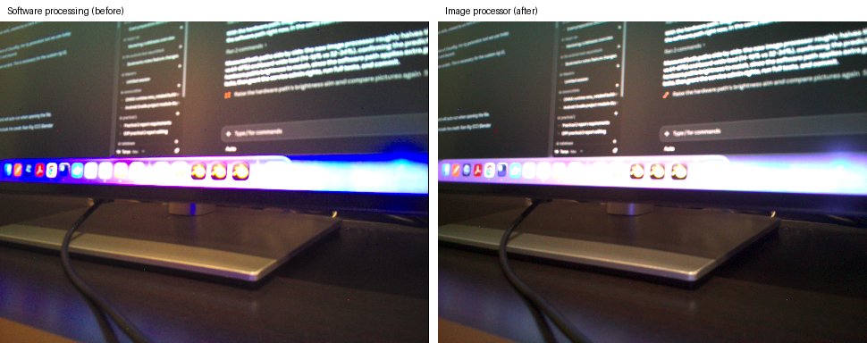

# Auris power budget: what was done on 15 October 2026

**Goal:** make the imager draw less power so it runs from a power bank, without lowering the frame rate or the quality.

**Branch:** `perf/power-budget` in `~/src/auris-c-power` on the BeagleBone. This is a separate git worktree of the auris-c repository; your working folder `~/src/auris-c` (branch `feat/cmb-config`, with its uncommitted changes) was not touched. The imager service runs the branch's build at power-up (see "What runs at power-up now").

## Summary

| Measure (same recording replayed as the audio input, 40 s) | Before | After |
|---|---|---|
| Imager CPU | 89.9% of one core | 64.3% of one core |
| Whole board busy (both cores) | 45.6–48.2% | 33.6–33.8% |
| Audio processing per active 10.7 ms step | 6.0 ms | 2.0 ms |
| Display packing per frame | 5.7 ms | 1.7 ms |
| Memory in use after boot | 266 MB | 116 MB |

The imager now uses about 28% less CPU, with no lower frame rate and the same localisation results. Power draw was **not** measured: that needs the USB meter between the power bank and the cable.

**Power-bank test after steps 1–3:** the board stayed on for 11 minutes, against about 3 before, and ran much cooler, but it still switched off. That led to step 4.

**After step 4** (camera on the chip's image processor), measured live in the same room, back to back:

| | Software camera processing | Image processor |
|---|---|---|
| Imager CPU | 64–67% of one core | 26–32% of one core |
| Whole board busy (both cores) | 32–34% | 14–16% |
| Camera time per shown frame | 23 ms | 14 ms (mostly waiting on the hardware) |

Compared with the start of the day, the imager's CPU use has gone from 90% of a core to under a third of a core.

## Where the CPU time went before

Measured on the board with the imager running at 20 frames per second (the `fps 20` in `configs/runtime_settings.txt`):

| Job | Cost | Share of one core |
|---|---|---|
| Camera image processing (raw sensor image to colour picture), in software | 23 ms per frame | about 46%, always |
| Audio processing (SRP-PHAT), while there is sound | 6.0 ms per 10.7 ms step | up to about 56% |
| Display packing (scale, rotate, convert the picture) | 5.7 ms per frame | about 11% |
| Background services (Node-RED, VS Code server, Docker) | busy only at boot | under 1% afterwards |

Also found: this kernel (5.10.168-ti) has no CPU frequency control, so the cores always run at full speed and "capping the CPU" is not available. Power can only drop by giving the CPU less work.

## 1. Background services turned off

**What:** disabled and stopped the services the imager does not use:

```bash
sudo systemctl disable --now nodered.service bb-code-server.service docker.socket docker.service containerd.service
```

- `nodered`: Node-RED, the browser-based wiring tool from the BeagleBoard image
- `bb-code-server`: the VS Code server on port 3000
- `docker.socket`, `docker`, `containerd`: Docker, which had no containers

**Effect:** memory in use dropped from 266 MB to 116 MB. Steady-state CPU barely changed: once booted, Node-RED had used 4 s of CPU in 12 minutes. The saving is mostly during boot and in memory.

**To undo:** `sudo systemctl enable --now` with the same five names.

## 2. Display: let the display hardware do the scaling

**Before:** every frame, the CPU scaled the 640×360 picture up to the panel's full 720×1280, rotated it, and wrote all 3.7 MB into display memory. Display memory is uncached, so writing to it is slow: that was the 5.7 ms.

**After:** the CPU writes the picture at its own size after rotation, 360×640, which is a quarter of the pixels. The display controller has scalers in some of its pipelines; one of them scales the picture to 720×1280 on the way to the panel, at no CPU cost. The normal full-screen layer stays black underneath.

**Details**
- `frontends/display/src/auris_display.c`:
  - looks for overlay planes that can show this picture format on the panel;
  - tries them in order until one accepts the scaled picture. On this board plane 40 refuses and plane 46 accepts.
  - If none accepts, it falls back to the old full-size CPU path. Startup messages say which path is in use.
- **For comparison:** setting `AURIS_DISPLAY_CPU_SCALE=1` forces the old CPU path.
- `frontends/display/src/auris_display_pack.c`:
  - the fit rectangle is now a shared function, `auris_display_fit`;
  - the packer works out each column's source once per frame instead of once per pixel. That on its own made no measurable difference; the time is in the memory writes.

**Measured:** packing 5.7 ms to 1.7 ms per frame. Imager CPU 71–72% to 64% of a core (with the audio change already in).

**Not checked by me:** how it looks on the screen. The hardware scaler smooths the picture slightly where the old path repeated pixels. If anything looks wrong, start the imager with `AURIS_DISPLAY_CPU_SCALE=1` to compare.

## 3. Audio: compute only what the map uses

**Before:** for every audio step with sound, the SRP-PHAT stage worked out each microphone pair's correlation curve with an inverse FFT of 8192 points. That is 28 pairs × 2 halves of the height band = **56 transforms**. It then read only about 235 points of each curve, the lags that the directions in the map correspond to. Most of the work was thrown away.

**After**
- **Correlation:** a new function `auris_gcc_phat_lags` works out the curve only at the lags that are needed. It sums the frequency bins directly, using a table of sines and cosines made once (`auris_fft_reserve_lags`). It uses the processor's NEON vector instructions.
- **Map search (`auris_srp.c`):**
  - keeps each pair's curve only over its own range of lags;
  - no longer does a division for every lookup;
  - adds up the scores one pair at a time across all map cells, so the data stays in the processor's cache.
  - The order in which values are added is unchanged.

**Results stay the same:** replaying all 18 recordings in `recordings/room1` and `room2` through the old and new versions:
- In 2 to 9 frames per recording, the third decimal place of the sub-cell position differs (about a thousandth of a cell).
- Every direction matches to six decimal places.
- The active/quiet decisions are identical.

**Measured**

| | Before | After |
|---|---|---|
| All 18 recordings, replay time | 81.6 s | 28.1 s (2.9× faster) |
| Per active audio step | 6.0 ms | 2.0 ms |

Files changed: `core/inc/auris_spectrum.h`, `core/src/auris_spectrum.c`, `core/src/auris_srp.c`.

## 4. Camera: processing on the chip's image processor (VPAC)

**Before:** the CPU turned every raw camera frame into a colour picture itself: 23 ms per frame, about half of one core, all the time.

**After:** the chip's built-in image processor does it. Our own camera capture (unchanged, full view, 1640×1232) hands each raw frame to TI's processing blocks:
- **VISS:** raw to colour, using TI's IMX219 tuning file.
- **MSC:** scaling down to the 480×360 picture on the canvas.

The CPU only:
- copies the frame in;
- measures it for exposure and white balance;
- draws the small result into the canvas.



### What was installed on the board

- **TI's tuning files:** `/opt/imaging/imx219/dcc_viss.bin` (17,111 bytes) and `dcc_2a.bin` (22,321 bytes). They come from TI's public imaging repository at git.ti.com (`processor-sdk/imaging`, tag `REL.PSDK.JACINTO.08.02.00.02`, folder `sensor_drv/src/imx219/dcc_bins`), the version that matches the board's TI 8.2 libraries. They are **not** in the repository: if the board is reflashed, put them back, or the imager quietly uses software processing.
- **Service settings:** the imager service now runs as root (`User=root` in `/etc/systemd/system/auris.service.d/power-budget.conf`), because TI's libraries need it (they map `/dev/mem`).

### What we found on the way

1. **TI's ready-made GStreamer camera tools can't take our full-view mode.** They have no 10-bit raw format on this GStreamer version, and they can't handle the 8-bit mode's padded rows. So our own capture feeds TI's processing library (TIOVX) directly.
2. **TI's statistics block stops the hardware on our frame size.** TI's automatic exposure and white balance ("2A") rely on statistics the hardware gathers (H3A), and TI's tuning sets those up for 1920-wide frames. Any narrower frame stops the hardware without finishing. That includes our 1640-wide full view, and a 1632-wide crop of a working 1920×1080 frame, which shows it is the width, not the alignment. When that happens, the processor's cores stay stuck until the board is rebooted.
   - **Choice:** the statistics block is left off, and **our own exposure and white balance** steer the picture: the same code the software path uses, measuring a sparse sample of each raw frame. Its gains are passed to the image processor. TI's statistics path is still in the code as an option (it works at 1920×1080).
3. **TI's tuning is for 8-bit samples.** Given our 10-bit samples, the picture came out washed out: the darkest 1% of pixels were at 135 out of 255.
   - **Choice:** the copy into the image processor keeps the top 8 bits of each sample, using vector instructions. Our exposure and white-balance measurement still uses all 10 bits.
4. **TI's picture is a little darker for the same exposure,** and the image processor has no extra software brightening. The exposure aim is therefore 0.22 instead of 0.16, and the sensor's digital gain may go to ×4 instead of ×2. In the test room the two paths now differ by 4 levels of median brightness (55 against 59 out of 255).

### Code

- `drivers/video/src/auris_vpac.c` (new): the image processor. Graph set-up, frame copy with 8-bit narrowing, white-balance input and the result picture. `auris_vpac_none.c` stands in on machines without TI's libraries, such as the Mac.
- `core/image/src/auris_nv12.c` (new): draws the image processor's NV12 picture into the RGB canvas and measures its brightness.
- `core/image/src/auris_image.c`: the picture-fit rule is now a shared function, `auris_image_fit`.
- `apps/camera_chain.c`:
  - uses the image processor when it can, otherwise the software path as before;
  - `AURIS_CAMERA_SOFTWARE=1` forces software;
  - the EXPOSURE status line ends with "image processor" when it is in use.
- New tools:
  - `apps/vpac_probe.c`: bring-up check that sends any camera mode or centre crop through the processor and reports each step.
  - `apps/camera_snapshot.c`: saves one picture from the camera chain, to compare the two paths.

### Limits to know about

- **If the imager is force-killed** (`kill -9`) while a frame is inside the image processor, the processor's cores can stay stuck until the next reboot, and the imager will hang at start-up. A normal stop or restart of the service is fine (tested twice). A power cycle also clears it.
- **Fixed colour matrix:** TI's tuning picks its colour matrix from the light's colour temperature. Without TI's statistics there is no estimate, so it is fixed at 4000 K (indoor lamps).
- **Lens-shading file not used:** your `configs/lens_shading.txt` correction is not applied to the hardware picture. TI's tuning uses its own.

## Tests

Written first, then the changes:
- `tests/test_gcc_lags.c`: the new correlation must match the full inverse FFT at every lag (within 2×10⁻⁶), with the same validity and weight. It covers band-limited and full spectra, with and without gains and per-bin weights.
- `tests/test_srp_reference.c`: map scores against a reference built the plain way from full curves, with and without the height band and the diffuse-field gains. It passed on the old code first, which confirms the reference is right.
- `tests/test_display.c`: added exact-size packing for every rotation, and `auris_display_fit`.

- `tests/test_nv12.c` (step 4): the image processor's picture drawn into the canvas. It checks black, white and pure red levels, one colour sample per 2×2 block, placement at an offset with the rest of the canvas left alone, brightness, and pictures that don't fit.
- `tests/test_camera_chain.c` (step 4): where the hardware picture sits on the canvas (480×360 at 80,0), and the software/hardware choice.

**Result: 42 of 42 tests pass** (Debug build with sanitizers). The image processor itself can only be tested on the board. That was done live with `vpac_probe`, `camera_snapshot` and the imager.

## Commits on `perf/power-budget`

| Commit | What |
|---|---|
| `98757dd` | Snapshot of your uncommitted `feat/cmb-config` work, so the branch starts from what was running |
| `045aec0` | The new tests |
| `5e78759` | Test fix: valid frame sizes |
| `83b35da` | Audio: GCC-PHAT only at the lags the map reads |
| `29f67bc` | Display: scaling on a display-controller plane |
| `a298523` | This document (first version) |
| `0e08906` | Tests for the image-processor picture path |
| `91a074e` | Camera: picture made on the image processor (VPAC) |
| this update | `docs/power-budget-2026-10-15.md` |

## What runs at power-up now

The imager service runs the new build from the branch, as root:

- `/etc/systemd/system/auris.service.d/power-budget.conf` points the service at `~/src/auris-c-power/scripts/auris-start.sh` and sets `User=root`.
- The service is enabled, so it starts at power-up.

**To compare with software camera processing:**
```bash
sudo systemctl stop auris
cd ~/src/auris-c-power && sudo AURIS_CAMERA_SOFTWARE=1 ./build-release/apps/imager_scope --array cmb --output display --rotation 270 --pan 3 --tilt 3 --diffuse 1
```
Press Ctrl-C to stop it, then `sudo systemctl start auris` to go back.

**To go back to your old build entirely:**
```bash
sudo rm /etc/systemd/system/auris.service.d/power-budget.conf && sudo systemctl daemon-reload && sudo systemctl restart auris
```

**To make it permanent:** merge `perf/power-budget` into your working branch, then remove the drop-in's `ExecStart` lines (keep `User=root`).

## Not done, and next steps

- **Power-bank test with step 4:** run the imager on the power bank again, ideally with the R90 USB meter between the power bank and the cable. Power draw has still not been measured.
- **Check the picture on the screen:** the image processor's colours and brightness were compared in one dim room only. Daylight and bright scenes are untested.
- **What is left on the CPU:**
  - per frame: the 8-bit copy in, the sparse measurement, drawing the picture, the overlay and display packing;
  - per active audio step: about 2 ms of audio processing.
- **Frame rate:** 20 fps is set in the runtime settings. Lowering it would save more, but was left alone as a trade-off, not an optimisation.
